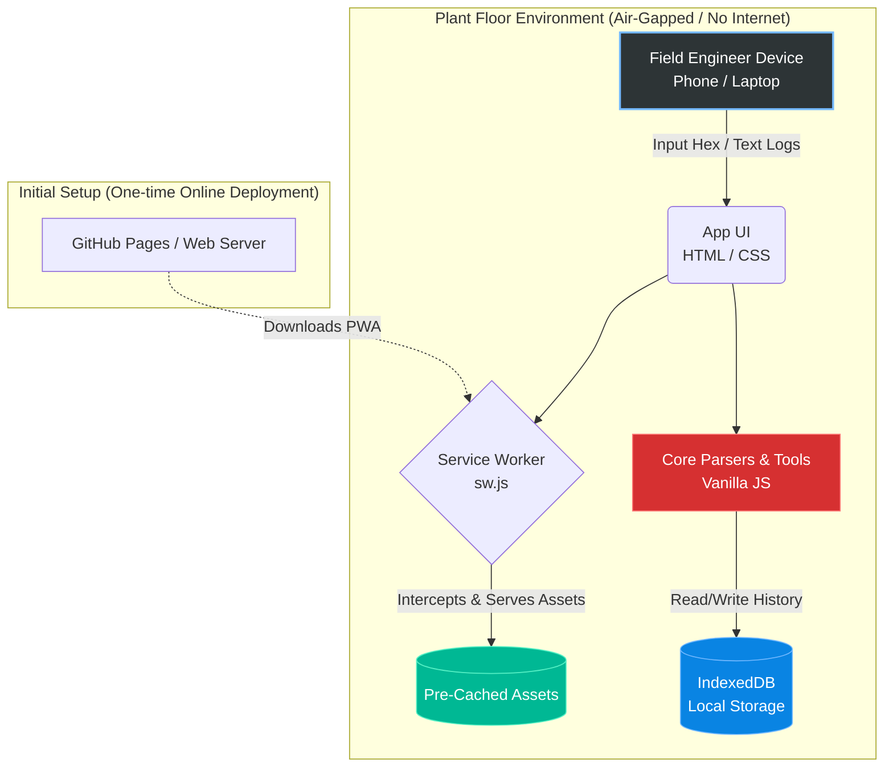

## 🎯 Purposes and Uses

Designed specifically for Industrial Automation and SCADA Engineers, this tool provides critical on-site diagnostic capabilities in remote, air-gapped, or highly secure environments where internet access is restricted.

* **Commissioning & SAT:** Validate raw serial or ethernet communications (Modbus RTU/TCP) directly on the plant floor before integrating with PLCs (Siemens, Allen-Bradley) or central SCADA platforms.
* **Rapid OPC Troubleshooting:** Resolve DCOM permissions, RPC failures, and connectivity errors at remote utility facilities without needing to search online manuals.
* **Diagnostics & Log Analysis:** Quickly parse Wonderware System Management Console (SMC) logs to isolate network drops, communication timeouts, and hardware faults.

---

## 🏗️ System Architecture & Data Flow

ProtoLink Diagnostics operates on a strict **zero-telemetry, 100% client-side** architecture. Because industrial logs and IP schemes are highly sensitive, data processing happens entirely within the browser's local sandbox.



### How Data Works:

1. **Pre-Caching:** Upon first visit, the Service Worker (`service-worker.js`) downloads all HTML, CSS, JS, and icons.
2. **Offline Execution:** Subsequent launches load instantly from the device's hard drive, bypassing network requests entirely.
3. **Log Parsing & Analysis:** All regex matching, hex decoding, and CRC calculations run in local browser memory (RAM).
4. **Persistence:** Saved frames and field notes are stored in the browser's IndexedDB. Clearing site data permanently deletes it.

---

## 💻 Core Features

| Module | Visual | Capabilities |
| --- | --- | --- |
| **Modbus Analyzer** | 🔀 | Auto-detects RTU/TCP/ASCII mode from hex input. Validates CRC-16/LRC/MBAP lengths and colour-codes bytes. Decodes function codes (01–06, 07, 08, 11, 15, 16, 17, 22, 23). Includes a visual frame builder. |
| **OPC Troubleshooter** | ⚙️ | Searchable offline knowledge base for DCOM hardening (KB5004442), RPC errors, OPC DA/UA error codes, and Modbus DAServer timeouts. Includes quality-byte decoders and a persistent DCOM checklist. |
| **Log Snippet Parser** | 📝 | Regex-powered text highlighter for `.log` or `.txt` files. Automatically flags HRESULT codes, Modbus exceptions, quality values, IPs, and component names. |
| **Engineering Tools** | 🧮 | Utilities for Modicon to protocol offset conversion, 32-bit register decoding (Int/Float across all byte orders), CRC/LRC calculators, and linear scaling (raw to engineering units). |

---

## 🚀 Deploy to GitHub Pages

1. Create a new GitHub repository (e.g. `protolink-diagnostics`) and upload the contents of this folder (with `index.html` at the repository root).
2. Navigate to **Settings → Pages → Build and deployment → Source: GitHub Actions.** The included workflow (`.github/workflows/deploy.yml`) runs tests, stamps the cache version, and deploys on every push to `main`.
*(Alternative: Source = "Deploy from a branch", `main` / `/ (root)`. The `.nojekyll` file is included so dot-folders are served.)*
3. Open `https://<user>.github.io/<repo>/` **once while online** — the service worker caches everything.
4. **Install as App:** On Android/Chrome use *Install app* from the URL bar; on iOS Safari use *Share → Add to Home Screen*.

### Before you publish (Placeholders to edit):

* `sitemap.xml`, `robots.txt`: replace `YOUR-USER.github.io/protolink-diagnostics` with your real URL.
* `security.txt`: replace the contact address.
* `humans.txt`, `LICENSE`: add your name/company.

---

## 🛠️ Local Development & Testing

```bash
npm start        # Hosts at http://localhost:8080 (Service workers require localhost or HTTPS)
npm test         # Runs CRC/LRC vectors, parser tests, and precache-list checks (Node ≥ 18)

```

*Note: Do not open `index.html` via `file://`, as the browser's security policies will block the service worker from registering.*

## 📌 Notes & Limits

* **Frame Direction:** Request vs. response is inferred from the PDU shape. FC 05/06 requests and echoed responses are identical. Use the **Direction** dropdown selector to force ambiguous payloads.
* **OPC Guidelines:** The built-in OPC guide serves as an offline field checklist, not official vendor documentation. Menu names and default ports differ across Windows and Wonderware versions.
* **Icons:** The repository includes both scalable vector graphics (`*.svg`) and real PNG renders (`icon-192.png`, `icon-512.png`, maskable) to satisfy both iOS and Android PWA installation requirements.
